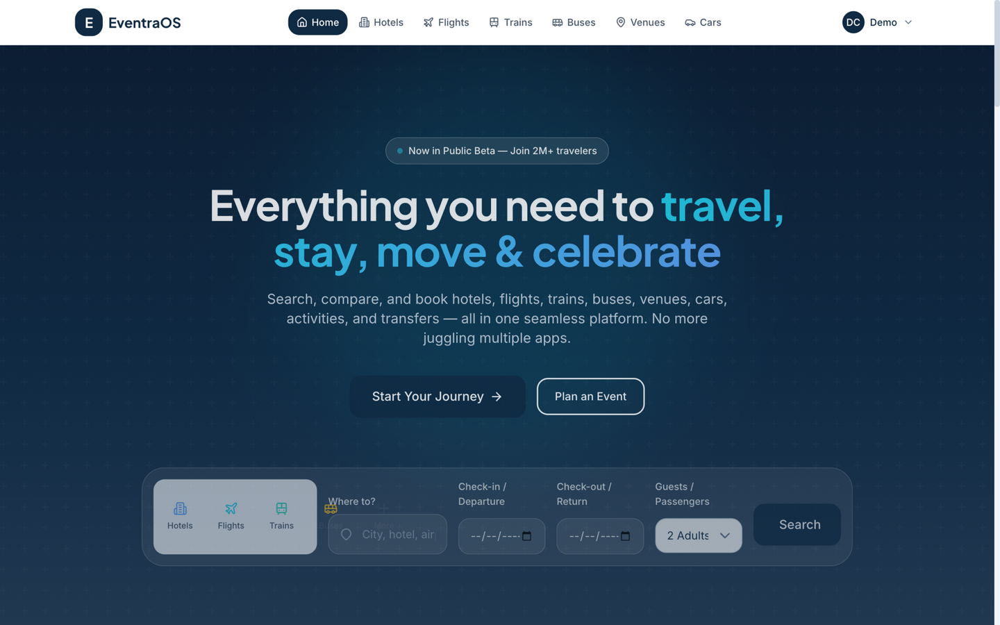
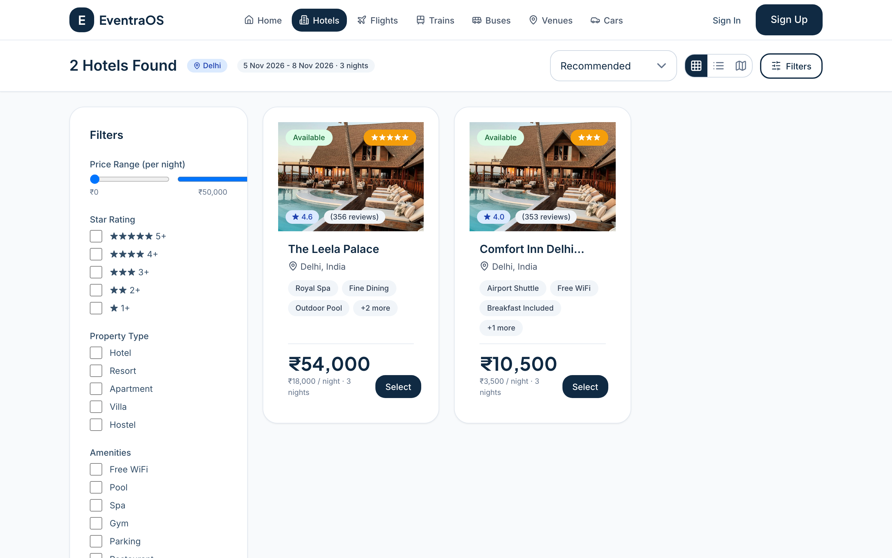
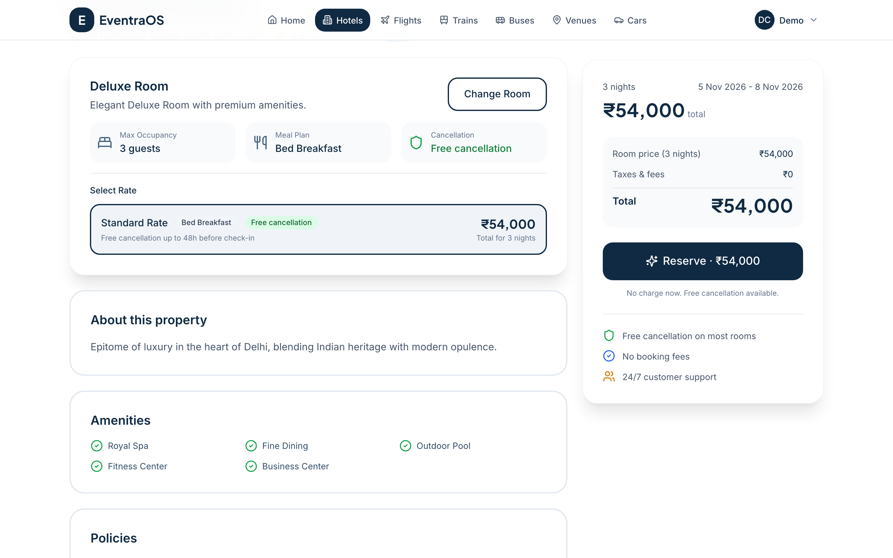
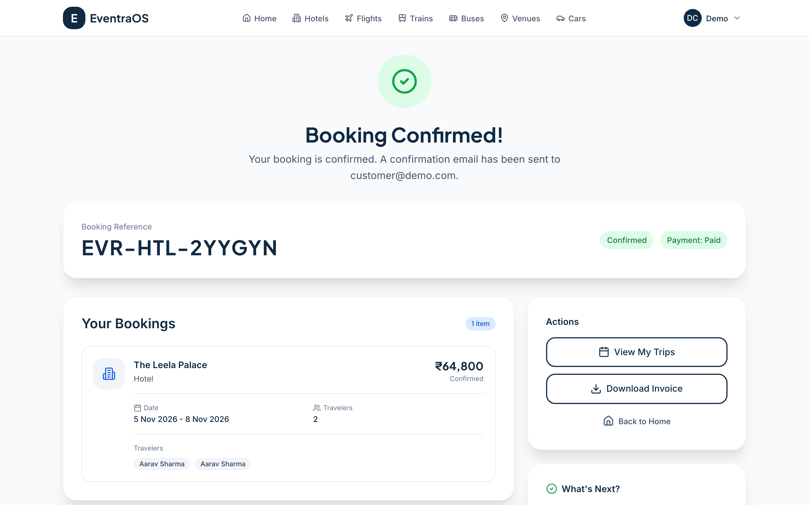
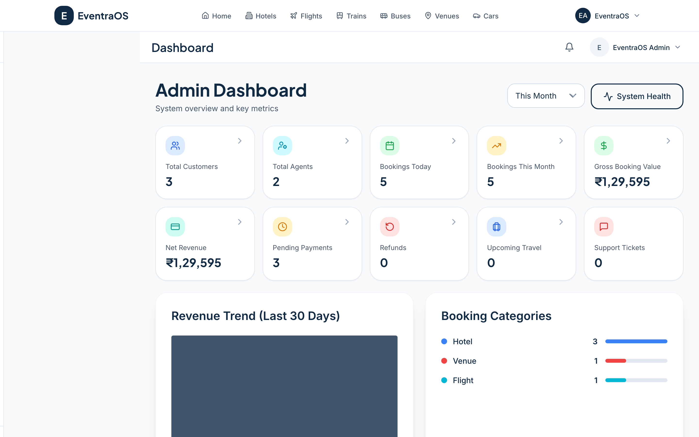
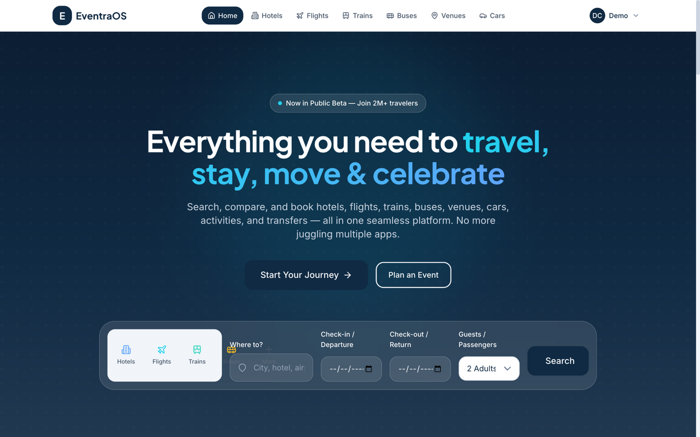
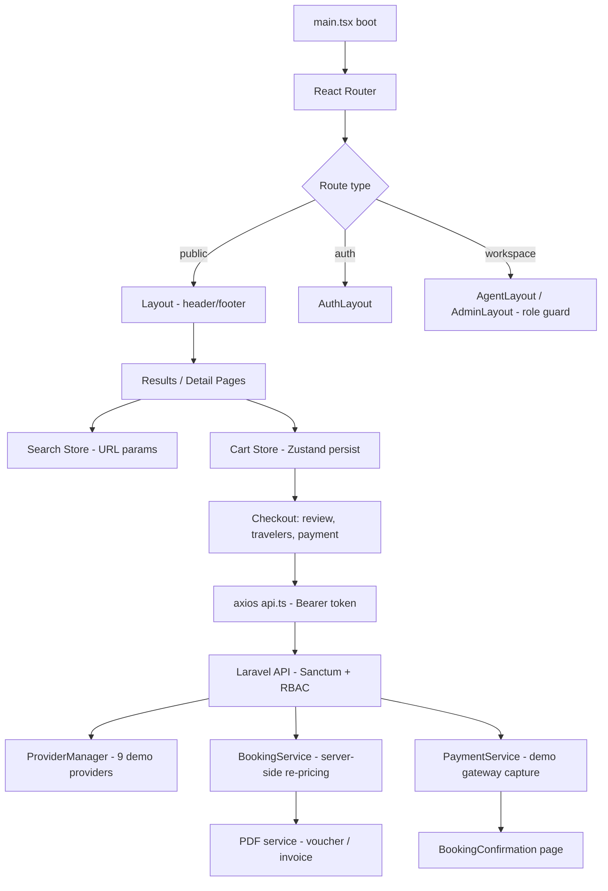

# EventraOS

**One platform to travel, stay, move & celebrate.** EventraOS is a full-stack, OTA-style (Online Travel Agency) booking platform covering **nine service verticals** — hotels, flights, trains, buses, venues, car rentals, activities, transfers and holiday packages — built as a **Laravel API** plus a **React + TypeScript SPA**, with dedicated workspaces for customers, travel agents and administrators.



*The EventraOS home page — hero, unified search widget and navigation.* See the [full screenshot index](docs/screenshot-index.md).

---

## Table of Contents

1. [What EventraOS Does](#1-what-eventraos-does)
2. [Project Highlights](#2-project-highlights)
3. [Visual Showcase](#3-visual-showcase)
4. [Application Route Reference](#4-application-route-reference)
5. [Technology Stack](#5-technology-stack)
6. [Architecture & Project Structure](#6-architecture--project-structure)
7. [Prerequisites](#7-prerequisites)
8. [Installation & Local Setup](#8-installation--local-setup)
9. [Running the Application](#9-running-the-application)
10. [Available Scripts](#10-available-scripts)
11. [Configuration & Environment Variables](#11-configuration--environment-variables)
12. [User Workflows](#12-user-workflows)
13. [Responsive Design](#13-responsive-design)
14. [Testing & Quality Checks](#14-testing--quality-checks)
15. [Known Limitations](#15-known-limitations)
16. [Development Guidelines](#16-development-guidelines)
17. [License & Support](#17-license--support)

---

## 1. What EventraOS Does

EventraOS is a complete booking pipeline for travel and events:

- **Search** nine inventory verticals through one provider-abstraction layer (a seeded demo provider ships for all nine services, generating rolling 30–45-day inventory).
- **Combine** any mix of services into a single cart and check out once.
- **Pay** through a pluggable payment engine (a fully working demo gateway auto-captures and confirms).
- **Manage** bookings afterwards: vouchers, invoices, cancellation, reschedule, refunds — as a customer, an agent booking on behalf of clients, or an administrator.

The demo seed creates three role accounts (see [Demo Credentials](#demo-credentials)) and a populated catalogue (12 cities, hotels, flights, trains, buses, venues, cars, activities, transfers and packages).

## 2. Project Highlights

- **9 booking verticals** with per-service filters, sorting and pagination — all served through `GET /api/search/{service}`.
- **Unified booking builder** — any combination of services in one cart, re-priced server-side at booking time.
- **Multi-step checkout** — cart review → traveler details → payment method → pay, with promo-code validation.
- **Booking lifecycle** — draft → payment_pending → confirmed, with cancellation, reschedule and refund flows.
- **PDF documents** — server-generated vouchers, invoices, credit notes and itineraries (Barryvdh DomPDF).
- **Provider abstraction** — every external integration (inventory and payments) sits behind adapter interfaces; swap the demo providers for real suppliers without touching application code.
- **Role-based workspaces** — 12 customer-account pages, 8 agent-workspace pages and 14 admin-console pages, protected by Spatie Laravel Permission middleware.
- **Platform features** — loyalty points, wallet, coupons, notifications, saved travelers, support ticketing, reviews, favorites, multi-currency scaffolding, audit logs and system health.

## 3. Visual Showcase

### Search & Discovery



*Hotel results with live seeded inventory, filter sidebar and per-night pricing. All nine verticals follow the same results/detail pattern — see [03-search](docs/screenshot-index.md#3-unified-search--the-nine-service-verticals) in the screenshot index.*

### Service Details



*Hotel detail: room types, rate plans with cancellation rules, amenities and a sticky price summary. Flight detail adds fare options and seat selection; venue detail adds packages, add-ons and a live event configurator.*

### Checkout & Confirmation


*The three-step checkout: review → travelers → payment, with the demo gateway auto-capturing and redirecting to a confirmation page that offers invoice/voucher downloads.*



*Booking confirmed: server-authoritative pricing, status badges and document downloads.*

### Role Workspaces



*Admin console: KPIs, revenue reporting, bookings/customers/agents/suppliers management, refunds, commissions, audit logs and system health. Agent and customer dashboards follow in the [screenshot index](docs/screenshot-index.md).*

### Mobile



*The same journey at 390×844: single-column layouts, a hamburger drawer with all nine services, and filter slide-overs on results pages.*

## 4. Application Route Reference

All routes are declared in `frontend/src/App.tsx` (54 distinct page views). Protected routes redirect unauthenticated visitors to `/login`; `/admin/*` and `/agent/*` additionally redirect users without the matching role.

| Route | Page | Access |
|---|---|---|
| `/` | Home | Public |
| `/search` | Unified search | Public |
| `/login`, `/register`, `/forgot-password` | Authentication (split-screen layout) | Public |
| `/hotels`, `/hotels/:id` | Hotel results / detail | Public |
| `/flights`, `/flights/:id` | Flight results / detail | Public |
| `/trains`, `/buses` | Train / bus results (add to cart directly) | Public |
| `/venues`, `/venues/:id` | Venue results / configurator | Public |
| `/cars`, `/activities`, `/transfers`, `/packages` | Results (add to cart directly) | Public |
| `/checkout` | 3-step checkout | Customer |
| `/booking/payment/:paymentId` | Payment processing (demo gateway) | Customer |
| `/booking/confirmation/:reference` | Booking confirmation + documents | Customer |
| `/customer/dashboard` | Stats, upcoming trips, notifications | Customer |
| `/customer/trips` | My Trips (filterable list) | Customer |
| `/customer/bookings/:id` | Booking detail, cancel/reschedule, PDFs | Customer |
| `/customer/wallet` | Wallet balance, add/withdraw, transactions | Customer |
| `/customer/loyalty` | Eventra Rewards points & tier | Customer |
| `/customer/coupons` | Available coupons | Customer |
| `/customer/favorites` | Saved services | Customer |
| `/customer/reviews` | My reviews | Customer |
| `/customer/notifications` | Notification center | Customer |
| `/customer/security` | Sessions, 2FA (TOTP), password | Customer |
| `/customer/travelers` | Saved traveler address book | Customer |
| `/customer/support` | Support tickets | Customer |
| `/agent` (+ `/dashboard`, `/customers`, `/booking-workspace`, `/quotes`, `/bookings`, `/commissions`, `/tasks`, `/support`) | Agent workspace (8 pages) | Agent |
| `/admin` (+ `/dashboard`, `/customers`, `/agents`, `/bookings`, `/suppliers`, `/venues`, `/hotels`, `/transports`, `/promotions`, `/payments`, `/refunds`, `/commissions`, `/reports`, `/audit-logs`) | Admin console (14 pages) | Admin |
| `*` | Redirects to `/` | — |

Results pages read per-service URL query params (e.g. `/hotels?destination=Delhi&check_in=…&check_out=…&rooms=…&adults=…`, `/flights?origin=DEL&destination=BOM&departure_date=…&adults=…`, `/venues?city=…&event_date=…&guest_count=…`) — links are shareable and bookmarkable. The backend API (`backend/routes/api.php`, 100+ route registrations) mirrors these areas under `/api/*` with Sanctum auth and role middleware.

## 5. Technology Stack

### Frontend (`frontend/`)
| Technology | Purpose |
|---|---|
| **React 18 + TypeScript 5** | UI (zero-error type-checked build via `tsc -b`) |
| **Vite 5** | Dev server, `/api` proxy, code-split production bundles |
| **React Router v6** | Nested layouts, protected routes, URL-driven search state |
| **TanStack Query v5** | Server state, keep-previous-data pagination |
| **Zustand (+persist)** | Auth session (`eventraos-auth`), cart (`eventraos-cart`), search params |
| **Tailwind CSS 3** | Custom `eventra-*` design system (typography scale, colour tokens, component classes) |
| **Framer Motion** | Page/step transitions, entrance animations |
| **React Hook Form + Zod** | Form state and validation (login, register, traveler details) |
| **React Hot Toast** | Feedback messages |
| **Lucide icons, Headless UI, Swiper, react-day-picker** | UI primitives |
| **ESLint 9 (flat config), Vitest, Playwright (tooling only)** | Quality gates |

### Backend (`backend/`)
| Technology | Purpose |
|---|---|
| **Laravel 13 (PHP 8.3+)** | API framework |
| **Laravel Sanctum** | Token authentication (SPA stateful mode) |
| **Spatie Laravel Permission** | Role/permission RBAC on customer/agent/admin route groups |
| **Spatie Laravel Activitylog** | Audit trails for critical operations |
| **Barryvdh DomPDF** | Voucher / invoice / credit-note / itinerary PDFs |
| **SQLite** | Zero-config local database (MySQL/PostgreSQL-compatible migrations) |

## 6. Architecture & Project Structure

```
EventraOS/
├── backend/                          # Laravel 13 API
│   ├── app/
│   │   ├── Http/Controllers/Api/     # Auth, Search, Booking, Payment, Customer, Agent, Admin…
│   │   ├── Models/                   # 100+ domain models (Booking, BookingItem, Payment, …)
│   │   ├── Services/
│   │   │   ├── Providers/            # ProviderManager + Demo*Provider for all 9 services
│   │   │   ├── Booking/              # BookingService: create → hold → confirm → cancel → refund
│   │   │   ├── Payment/              # Gateway-agnostic payment pipeline + demo gateway
│   │   │   ├── PDF/                  # Voucher / invoice / credit-note / itinerary generators
│   │   │   └── …                     # Notification, Commission, Loyalty, Tax, Currency services
│   │   └── Mail/                     # Queueable mailables
│   ├── database/migrations/          # 30 migrations (full travel domain)
│   ├── database/seeders/             # Demo users, rolling inventory, promotions, payment methods
│   ├── resources/views/pdf/          # Blade templates for PDF documents
│   ├── routes/api.php                # 100+ API routes with RBAC middleware
│   └── tests/Feature/ApiSmokeTest.php# End-to-end API smoke suite
│
├── frontend/                         # React 18 + TypeScript SPA
│   ├── src/
│   │   ├── App.tsx                   # Route table, protected routes, session boot
│   │   ├── layouts/                  # Layout (public), AuthLayout, AdminLayout, AgentLayout
│   │   ├── pages/
│   │   │   ├── public/               # Home, unified SearchPage
│   │   │   ├── hotels|flights|trains|buses|venues|cars|activities|transfers|packages/
│   │   │   ├── checkout/             # Checkout, PaymentProcessing, BookingConfirmation
│   │   │   ├── auth/                 # Login, Register, ForgotPassword
│   │   │   ├── customer/             # 12 customer-account pages
│   │   │   ├── agent/                # 8 agent-workspace pages
│   │   │   └── admin/                # 14 admin-console pages
│   │   ├── components/ui/            # Button, Input, Modal, Card, Badge, Avatar, skeletons…
│   │   ├── hooks/                    # useAuth, useBookings, useSearch, useDebounce…
│   │   ├── store/                    # Zustand: auth, cart, search
│   │   ├── lib/                      # api.ts (axios client + interceptors), utils, formatters
│   │   └── index.css                 # eventra-* design tokens & component classes
│   ├── eslint.config.js              # ESLint 9 flat config
│   └── vite.config.ts                # Dev server + preview proxy, manual chunks
│
└── docs/                             # This audit's deliverables
    ├── screenshots/                  # 69 screenshots, organized by area (see screenshot-index.md)
    ├── screenshot-index.md
    ├── test-coverage.md
    └── ui-audit.md
```

### How the pieces fit



**Provider abstraction.** Every vertical goes through `ProviderInterface` (`search`, `getDetails`, `checkAvailability`, `createHold`, `confirmBooking`). `DemoHotelProvider` & friends read seeded inventory; replacing them with real supplier APIs requires no application-code changes.

**Server-side re-pricing.** The cart is a client-side convenience only. `BookingService::calculateItemPrice()` recomputes every line from provider data (honouring `fare_id` / `package_id` selections), applies tax (18%) and service fees (2%), so client prices are never trusted.

**State machine.** `DRAFT → PAYMENT_PENDING → CONFIRMED → COMPLETED`, with `CANCELLED → REFUND → CREDIT NOTE` branches. Cancellation and reschedule are available on confirmed bookings from the customer's booking-detail page.

## 7. Prerequisites

| Requirement | Version | Notes |
|---|---|---|
| PHP | **8.3+** | with `pdo_sqlite` (and `pdo_mysql`/`pdo_pgsql` if not using SQLite) |
| Composer | 2.x | backend dependencies |
| Node.js | 18+ (tested on 24) | frontend |
| npm | 9+ | ships with Node |
| A modern browser | — | for the SPA |

No external services are required for local development: SQLite works out of the box and the demo payment gateway auto-captures.

## 8. Installation & Local Setup

The project folder already contains both applications. From the repository root:

**1. Backend**

```bash
cd backend
composer install

# Configure environment — SQLite works out of the box
cp .env.example .env
php artisan key:generate

# Create schema + demo data (users, inventory, promotions, payment methods)
php artisan migrate --seed
```

**2. Frontend**

```bash
cd ../frontend
npm install
cp .env.example .env   # sets VITE_API_URL=/api (dev proxy)
```

### Demo Credentials

All demo accounts use the password **`password`**.

| Role | Email |
|---|---|
| Admin | `admin@demo.com` |
| Agent | `agent@demo.com` |
| Customer | `customer@demo.com` |

> Seeders generate demo inventory for **~30–45 days from the seed date**. If searches return empty results, refresh with `php artisan migrate:fresh --seed`.

## 9. Running the Application

**Backend API**

```bash
cd backend
php artisan serve --port=8000        # API at http://localhost:8000/api
```

**Frontend dev server**

```bash
cd frontend
npm run dev                          # SPA at http://localhost:5173
```

The Vite dev server proxies `/api/*` to `http://localhost:8000`. If port 5173 is occupied, Vite picks the next free port (e.g. 5174) — use whatever URL the terminal prints.

**Production build & local preview**

```bash
cd frontend
npm run build                        # type-checks (tsc -b) and bundles into dist/
npm run preview                      # serves dist/ at http://localhost:4173, /api proxied
```

Stop either server with `Ctrl-C`.

## 10. Available Scripts

### `frontend/package.json`
| Script | Purpose |
|---|---|
| `npm run dev` | Vite dev server with `/api` proxy |
| `npm run build` | `tsc -b` type-check + production bundle into `dist/` |
| `npm run preview` | Serve the production bundle with the same `/api` proxy |
| `npm run lint` | ESLint (flat config; currently **0 errors**, 138 warnings in utility code) |
| `npm run test` | Vitest unit tests (48 tests over `lib/utils`) |
| `npm run test:ui` | Vitest browser UI |
| `npm run test:e2e` | Playwright runner (no E2E specs exist in the repo) |

### `backend/`
| Command | Purpose |
|---|---|
| `php artisan serve --port=8000` | API server |
| `php artisan migrate --seed` | Schema + demo data |
| `php artisan test` | Feature test suite (in-memory SQLite) |
| `php artisan migrate:fresh --seed` | Rebuild demo data (also refreshes rolling inventory) |

## 11. Configuration & Environment Variables

### `frontend/.env`
| Variable | Default | Purpose |
|---|---|---|
| `VITE_API_URL` | `/api` | API base URL. Keep `/api` locally (dev/preview proxy); set an absolute URL for deployed builds |

### `backend/.env` (relevant keys)
| Variable | Default | Purpose |
|---|---|---|
| `DB_CONNECTION` | `sqlite` | SQLite file at `backend/database/database.sqlite`; switch to `mysql`/`pgsql` and re-migrate if preferred |
| `QUEUE_CONNECTION` | `database` | Mailables are queued. `sync` delivers inline; `database`/`redis` need a worker (`php artisan queue:work`) — see [Known Limitations](#15-known-limitations) |
| `APP_URL` | `http://localhost:8000` | Used for asset/links in PDFs and mail |
| `BOOKING_HOLD_DURATION_MINUTES` | config default 15 | Inventory hold window during checkout |

No secrets are required for local development; never commit real credentials.

## 12. User Workflows

### Booking journey (customer) — fully verified end-to-end
1. **Search** from the home widget or `/search` (destination/dates/guests are carried into every results page).
2. **Compare** results with filters/sorting; open a detail page (hotel/flight/venue) or add directly to the cart (train/bus/car/activity/transfer/package).
3. **Configure** — hotel: room + rate plan; flight: fare + seats; venue: package + add-ons with live total.
4. **Reserve** → the cart (persisted in localStorage) shows the item with an 18% tax + 2% service-fee estimate.
5. **Checkout** (login required): review → traveler details (first/last/email required, passport fields for flights) → payment method.
6. **Pay** — the demo gateway captures automatically; the UI polls payment status and redirects to the confirmation page with the booking reference and server-computed total.
7. **After booking** — download the invoice/voucher PDFs, view it in My Trips, cancel or reschedule while confirmed.

*Verification note:* this journey was completed twice from clean sessions during the audit (see `docs/test-coverage.md`). The demo gateway performs no real charge. One backend limitation currently prevents a manually-selected **hotel room** from being transmitted to the booking API (the server books the auto-selected first room); details in `docs/ui-audit.md` §5.

### Agent workflow
Log in as `agent@demo.com` → workspace with targets/pipeline dashboard, customer management, a multi-service booking workspace, quotes, bookings, commissions, tasks and support. The workspace's provider-search and multi-service actions are UI stubs (toast feedback) — creating a booking happens through the standard search/checkout flow.

### Admin workflow
Log in as `admin@demo.com` → console with KPI dashboard + revenue reports (range selector), management tables for customers/agents/bookings/suppliers/venues/hotels/transports, promotions, payments, refund approvals, commission approvals and audit logs. Destructive actions (delete customer/agent, refunds) use confirmation modals and were deliberately **not** executed during testing.

## 13. Responsive Design

Tested at **1440×900**, **768×1024** and **390×844** (plus programmatic horizontal-overflow checks on every route):

- Navigation collapses to a hamburger drawer below `lg` with all nine services ([mobile nav open](docs/screenshots/09-responsive/mobile-nav-open.png)).
- Results pages swap the desktop filter sidebar for a slide-over Filters modal ([open state](docs/screenshots/09-responsive/hotel-filters-mobile-open.png)).
- Admin/agent sidebars become slide-overs with a dimmed overlay ([admin sidebar](docs/screenshots/09-responsive/admin-mobile-sidebar.png)).
- Checkout, dashboards and detail pages stack to single columns ([checkout mobile](docs/screenshots/09-responsive/checkout-mobile.png), [dashboard mobile](docs/screenshots/09-responsive/customer-dashboard-mobile.png)).

A dashboard overflow defect at 390 px was found and fixed during the audit. No universal device compatibility is claimed beyond the tested viewports.

## 14. Testing & Quality Checks

| Check | Result |
|---|---|
| `npx tsc -b` | ✅ clean |
| `npm run lint` | ✅ 0 errors (138 pre-existing warnings, documented) |
| `npm run test` | ✅ 48/48 unit tests |
| `npm run build` | ✅ production build succeeds |
| Browser coverage | ✅ 54/54 routes rendered & exercised; 2 full booking journeys; 3 viewports |

Detailed records: [`docs/test-coverage.md`](docs/test-coverage.md) (route matrix, interaction tests, observations) and [`docs/ui-audit.md`](docs/ui-audit.md) (29 defects found & fixed, with root causes). Screenshots: [`docs/screenshot-index.md`](docs/screenshot-index.md).

Manual browser testing and scripted checks were both used; the frontend has no component/E2E suite in the repo (Playwright is installed as tooling but contains no specs — the backend's `ApiSmokeTest` covers the API end-to-end).

## 15. Known Limitations

- **Hotel room selection is not transmitted to the booking API** — a backend defect in `DemoHotelProvider::checkAvailability()` rejects any explicit `room_type_id`, so the server books the first room (which the UI auto-selects by default). Flights (`fare_id`) and venues (`package_id`) transmit correctly. Requires a small backend fix; documented in `docs/ui-audit.md` §5.1.
- **My Trips dates** — `service_date` is never populated on booking items by the backend, so trip cards show "Dates on request" (`docs/ui-audit.md` §5.2).
- **Emails are queued but not delivered** in the default dev setup (`QUEUE_CONNECTION=database`, no worker running); the confirmation page's "email sent" copy assumes delivery.
- **Seed-data artefacts** — e.g. hotel addresses contain random placeholder text ("DPTwMiebuK Street"); inventory is date-bound and needs re-seeding.
- **UI stubs** (toast-only, by design): Google/Apple sign-in, map views, travel-insurance, hotel share/favourite, review editing, live chat, agent provider-search & multi-service workspace actions.
- **Footer placeholder links** (`#`) exist for pages that don't exist (Privacy Policy, Terms, Careers…).
- No automated browser-test suite ships with the frontend.

## 16. Development Guidelines

- **Start everything:** backend on `:8000`, frontend `npm run dev`. Keep `VITE_API_URL=/api`.
- **Before committing frontend changes:** `npx tsc -b`, `npm run lint`, `npm run test`, and `npm run build` should all pass (current state: all green).
- **Design system:** use the `eventra-*` Tailwind tokens and shared UI components in `src/components/ui/` — pages compose `Button`, `Card`, `Modal`, skeletons and the typography scale rather than ad-hoc styles.
- **Server state** goes through TanStack Query; **session/cart** through the Zustand stores. Don't call `axios` directly — use `src/lib/api.ts` (attaches the Bearer token and correlation IDs).
- **New pages** belong in `src/pages/<area>/`, get lazy-registered in `App.tsx`, and reuse `ProtectedRoute` plus the matching layout.
- **Testing boundaries:** keep the demo database clean — don't exercise destructive admin actions or external services; the demo gateway is safe.

## 17. License & Support

No licence file is present in the repository — all rights are reserved by the project owner until a licence is added. (The previous README claimed MIT; that claim was not backed by a `LICENSE` file.)

For issues or questions about this codebase, contact the repository owner. Documentation in this repository:

- [`docs/screenshot-index.md`](docs/screenshot-index.md) — 69 annotated screenshots
- [`docs/test-coverage.md`](docs/test-coverage.md) — what was tested and how
- [`docs/ui-audit.md`](docs/ui-audit.md) — every issue found and fixed, with root causes

---

**EventraOS** — one platform for travel, stays, events, transportation and experiences.
